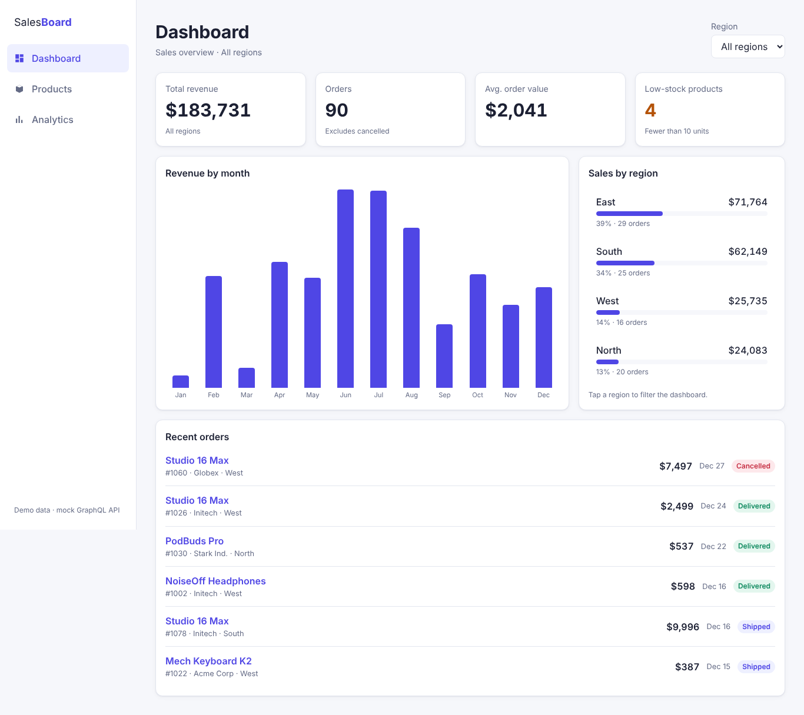
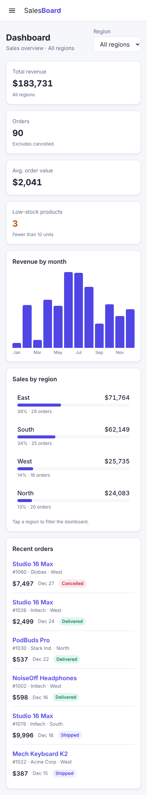
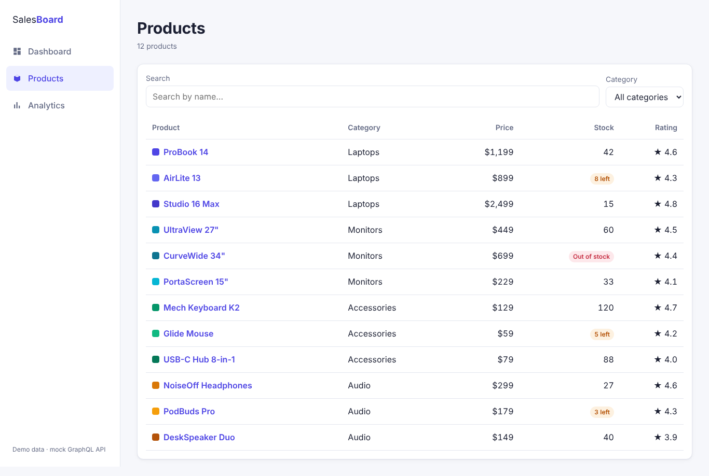

# SalesBoard

A responsive sales analytics dashboard built with **Vue 3**, a **GraphQL** API, and an embedded **Tableau** view.



## Features

- **Dashboard** with revenue, order and stock KPIs, monthly revenue chart, sales by region, and recent orders
- **Region filter** shared across pages with Pinia; click a region bar or use the dropdown
- **Product catalog** with debounced search and category filter, synced to the URL
- **Product detail** page with nested order data and a stock update form (GraphQL mutation)
- **Analytics** page with an embedded Tableau dashboard (Tableau Embedding API v3)
- **Responsive layout**: fixed sidebar on desktop, slide-in menu on phones, table rows become cards on small screens
- **Dark mode** that follows the operating system setting
- Consistent **loading, error and empty states** with retry

<p>
  
  &nbsp;
  
</p>

## Tech stack

| Area | Tools |
|---|---|
| Frontend | Vue 3 (Composition API, `<script setup>`), Vue Router, Pinia, Vite |
| API | GraphQL, GraphQL Yoga, Node.js |
| Analytics | Tableau Embedding API v3 |
| Styling | Plain CSS with design tokens, CSS Grid, Flexbox |

## Getting started

Requires Node.js 20.19+ or 22.12+.

```bash
git clone https://github.com/anisur-rahman/sales-dashboard.git
cd sales-dashboard
npm install
npm run dev
```

| URL | Description |
|---|---|
| http://localhost:5173 | Vue app |
| http://localhost:4000/graphql | GraphQL API with GraphiQL explorer |

Optional: copy `client/.env.example` to `client/.env` to change the GraphQL endpoint or the Tableau dashboard URL.

## Project structure

```
sales-dashboard/
├── server/                  GraphQL API
│   ├── index.js             HTTP server and GraphiQL
│   ├── schema.js            Type definitions and resolvers
│   └── data.js              Sample products and orders
│
└── client/                  Vue 3 app
    ├── vite.config.js       Vue plugin, Tableau custom element, API proxy
    └── src/
        ├── router/          Routes with lazy-loaded pages
        ├── stores/          Pinia store for shared filters
        ├── graphql/         GraphQL client, queries, fragments, mutation
        ├── composables/     useQuery and useMutation
        ├── components/      Reusable UI (KPI cards, charts, table, Tableau embed)
        ├── views/           Dashboard, Products, Product detail, Analytics
        ├── utils/           Currency and date formatting
        └── assets/          Global styles and design tokens
```

## How data flows

1. A page calls the `useQuery` composable with a GraphQL query and reactive variables.
2. `useQuery` sends the request through a small fetch-based client and exposes `data`, `loading` and `error`.
3. In development, Vite proxies `/graphql` to the API server on port 4000.
4. GraphQL Yoga runs the resolvers and returns only the requested fields.
5. When the variables change (for example, a new region), the query runs again and the page updates. Responses from outdated requests are ignored.

## Example queries

Try these in GraphiQL at http://localhost:4000/graphql.

```graphql
query ($region: String) {
  dashboard(region: $region) {
    totalRevenue
    totalOrders
    salesByRegion { region revenue }
  }
}
```

```graphql
{
  product(id: "3") {
    name
    totalRevenue
    orders(limit: 3) { id customer total }
  }
}
```

```graphql
mutation {
  updateStock(id: "8", stock: 30) { name stock lowStock }
}
```

## Roadmap

Planned improvements. Checked items are done.

### GraphQL API
- [ ] Add a `description` field to products and show it on the product page
- [ ] Add a `topCustomers` query with a matching dashboard card
- [ ] Add a `createProduct` mutation with an input type and a form

### UI and UX
- [ ] Sortable product table (price, stock)
- [ ] Two-column KPI cards on phones

### State management
- [ ] Keep product search and category filters in Pinia across pages

### Tableau
- [ ] Add a filter control using the Embedding API's `applyFilterAsync`

### Quality
- [ ] Cross-browser testing on Safari, Chrome, Firefox and Edge
- [ ] Responsive testing on phone and tablet sizes

## Notes

The API uses in-memory sample data, so changes made through mutations reset when the server restarts. The Analytics page embeds Tableau's public Superstore sample dashboard and needs an internet connection.
